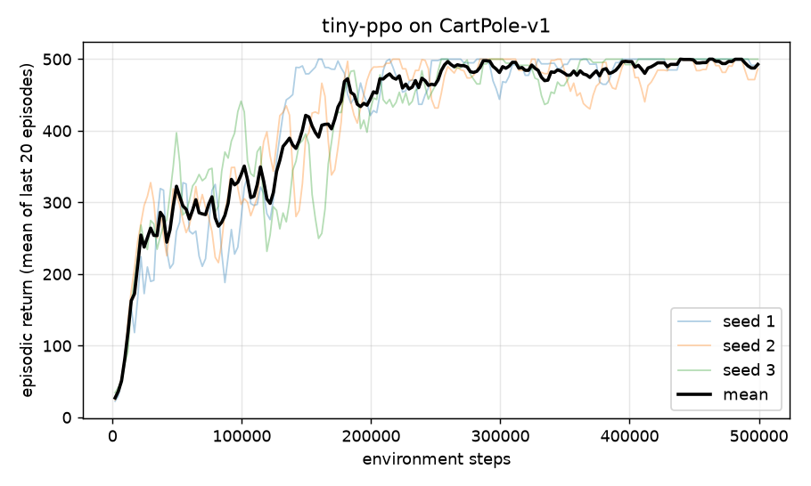

# tiny-ppo

A PPO implementation in one file of PyTorch (`ppo.py`, about 230 lines), for Gymnasium environments with discrete actions. It trains on CartPole-v1 by default and comes with a small script that plots learning curves across seeds.

## Why I built it

I wanted to be sure I understood PPO and not just able to call a library that does it. Writing it out, with every detail that matters kept in, was the fastest way to find the gaps. The code is meant to be read top to bottom in one sitting.

## Quick start

```bash
uv venv && source .venv/bin/activate
uv pip install -e ".[dev]"          # or: python -m venv .venv && pip install -e ".[dev]"
pytest -q

# train three seeds and plot them (about 70 seconds on my laptop)
for s in 1 2 3; do python ppo.py --seed $s --total-timesteps 500000 --out runs/seed$s.json; done
python plot.py runs/seed1.json runs/seed2.json runs/seed3.json --out assets/learning_curve.png
```

Other flags: `--env-id`, `--num-envs`, `--num-steps`, `--learning-rate`, `--no-anneal-lr`, `--gamma`, `--gae-lambda`, `--num-minibatches`, `--update-epochs`, `--clip-coef`, `--ent-coef`, `--vf-coef`, `--max-grad-norm`. Run `python ppo.py --help` for the defaults.

## How it works

Four environments run in a synchronous vector env. Each iteration collects 128 steps from each of them (512 transitions), computes advantages with GAE (gamma 0.99, lambda 0.95), then does 4 epochs of minibatch updates over that batch.

What is in the loss and the update:

- Clipped surrogate policy objective, clip coefficient 0.2.
- Clipped value loss, plus a 0.5 weight on it.
- Entropy bonus, coefficient 0.01.
- Advantages normalised per minibatch.
- Orthogonal init: gain sqrt(2) on hidden layers, 0.01 on the policy head, 1.0 on the value head.
- Learning rate annealed linearly to zero (starts at 2.5e-4, Adam).
- Gradient norm clipped at 0.5.

The actor and critic are separate two-layer tanh MLPs with 64 units. One detail worth knowing: I use Gymnasium's same-step autoreset, and treat a truncation (the 500-step time limit) as a terminal state for bootstrapping. That is a small bias, and it is the common simplification.

## Results

Three seeds (1, 2, 3), 500,000 environment steps each, CPU only, one process at a time. Each run took about 21 seconds, so 63 seconds of training in total (73 seconds with Python start-up and imports).

| seed | final average return (last 20 episodes) | wall time |
|------|------|------|
| 1 | 491.4 | 20.9 s |
| 2 | 486.7 | 20.7 s |
| 3 | 500.0 | 21.0 s |
| mean | 492.7 | |

500 is the maximum for CartPole-v1. The thin lines in the plot are single seeds and the black line is the mean, all smoothed over the last 20 episodes.



The curve is not smooth. It gets to around 300 quickly, stalls for a while, then climbs to the cap at roughly 250,000 steps. All three seeds got there, but with three seeds I can say little about variance.

## Limits

- Discrete actions and flat vector observations only. No continuous control, no image inputs.
- Three seeds on one easy environment. It says the implementation works, not that it matches a reference library on harder tasks. I did not run a head-to-head against another PPO.
- No observation or reward normalisation, so I would not expect it to do well on environments like MuJoCo tasks as is.
- Single process. The vector env is synchronous.

## What I would do next

Add a continuous-action head and run it on a small MuJoCo task. Then compare it against a reference implementation on the same seeds, so the claim "it matches" is something I measured. I would also add a proper handling of truncation versus termination.
